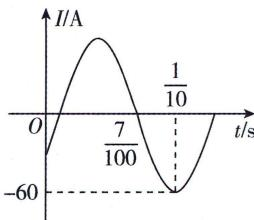

4. (多选) [甘肃白银部分学校 2025 高一期末联考] 已知一正弦电流 $I$ (单位: A) 随时间 $t$ (单位: s) 变化的函数 $I = A \sin(\omega t + \varphi)$ ( $A > 0, \omega > 0$ , $|\varphi| < \frac{\pi}{2}$ ) 的部分图象如图所示, 则 ( )

A. $A = 60$ B. $\omega = \frac{50\pi}{3}$ C. $\varphi = \frac{\pi}{6}$

D. 在一个周期内, 电流不超过 $30 \mathrm{~A}$ 的时长为 $\frac{2}{25} \mathrm{~s}$
