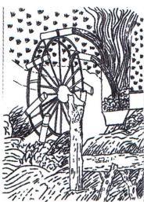
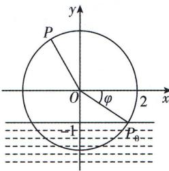

6. (多选)[江苏淮安 2025 高一期末]筒车是我国古代发明的一种水利灌溉工具, 因其经济又环保, 至今还在农业生产中使用(图①), 明朝科学家徐光启在《农政全书》中用图画描绘了筒车的工作原理(图②). 若一半径为 2 米的筒车水轮的圆心 O 距离水面 1 米(图③), 已知水轮按逆时针转动, 每分钟匀速转动 4 圈, 当水轮上点 P 从水中浮现时(图③中点 $P_{0}$ 的位置)开始计时, 点 P 距水面的高度(在水面上时为正值, 在水面下时为负值) d(单位: 米) 与时间 x (单位: 秒) 的关系可以用 $d = A \sin(\omega x + \varphi) + B \left(A > 0, \omega > 0, |\varphi| < \frac{\pi}{2}, B \in \mathbb{R}\right)$ 表示. 下列结论正确的有 ( )

图①

图②

图③

A. $d = 2\sin \left(\frac{2\pi}{15} x - \frac{\pi}{3}\right) + 1$ B.点 $P$ 第一次到达最高点需用时5秒C.点 $P$ 再次接触水面需用时10秒D.当点 $P$ 运动2.5秒时，距水面的高度为1.5米
