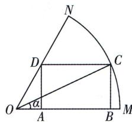

8.[陕西西安长安区一中2025高一期末]近年来,西安市长安区认真践行“绿水青山就是金山银山”的生态文明理念,围绕良好的生态禀赋和市场需求,深挖冷水鱼产业发展优势潜力,摸索出以虹鳟、鲟鱼等养殖为主的方向.为扩大养殖规模,某鲟鱼养殖场计划在如图所示的扇形区域OMN内修建矩形水池ABCD,矩形一边AB在OM上,点C在圆弧MN上,点D在边ON上,且 $\angle MON=\frac{\pi}{3}$ ,OM=60米,设 $\angle COM=\alpha$ .

(1)求扇形 OMN 的面积;

(2)求矩形 ABCD 的面积 $S(\alpha)$ ，当 $\alpha$ 为何值时， $S(\alpha)$ 取得最大值，并求出这个最大值.

## 相关知识点

暂无已审核的相关知识点。

> 来源：2026版 高中必刷题数学必修第一册
