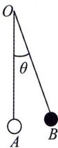

1. 如图所示, 一个单摆以 OA 为始边, OB 为终边的角 $\theta(-\pi<\theta<\pi)$ 与时间 t (单位: s) 满足函数关系式 $\theta=\frac{1}{2}\sin\left(2t+\frac{\pi}{2}\right), t\in[0,+\infty)$ , 则当 t=0 s 时, 角 $\theta$ 的大小及单摆频率是 ( )
A. $2, \frac{1}{\pi}$ B. $\frac{1}{2}, \frac{1}{\pi}$ C. $\frac{1}{2}, \pi$ D. $2, \pi$

