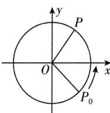

2. 如图, 质点 P 在以坐标原点 O 为圆心, 半径为 1 的圆上逆时针做匀速圆周运动, 质点 P 运动的角速度大小为 2 rad/s, 起点

$P_{0}$ 为射线 $y = -x (x \geqslant 0)$ 与 $\odot O$ 的交点. 则当 $0 \leqslant t \leqslant 12$ 时, 下列选项中, 是动点 P 的纵坐标 y 关于时间 t (单位: s) 的函数的单调递增区间的是
A. $\left[0,\frac{\pi}{2}\right]$ B. $\left[\frac{7\pi}{8},\frac{11\pi}{8}\right]$ C. $\left[\frac{11\pi}{8},\frac{15\pi}{8}\right]$ D. $\left[\frac{3\pi}{4},\frac{11\pi}{4}\right]$

