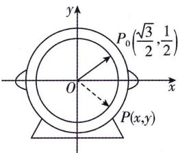

3.[江苏连云港2025高一期末]为了研究钟表与三角函数的关系,建立如图所示的坐标系,设秒针针尖位置为 $P(x,y)$ .若初始位置为 $P_{0}\left(\frac{\sqrt{3}}{2},\frac{1}{2}\right)$ ,当秒针针尖从 $P_{0}$ (注:此时t=0)正常开始走时,点P的纵坐标y与时间t(单位:秒)的函数关系式为()

A. $y = \sin \left(\frac{\pi}{30} t + \frac{\pi}{6}\right)(t\geqslant 0)$ B. $y = \sin \left(-\frac{\pi}{60} t - \frac{\pi}{6}\right)(t\geqslant 0)$ C. $y = \sin \left(-\frac{\pi}{30} t + \frac{\pi}{6}\right)(t\geqslant 0)$ D. $y = \sin \left(-\frac{\pi}{30} t + \frac{\pi}{3}\right)(t\geqslant 0)$

## 相关知识点

暂无已审核的相关知识点。

> 来源：2026版 高中必刷题数学必修第一册
