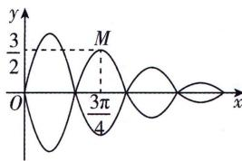

4.[北京人大附中2025质量检测]音乐喷泉曲线形似藤蔓上挂结的葫芦,也可称为葫芦曲线,它的性质是每经过相同的时间间隔,它的振幅就变化一次.如图所示,某一条葫芦曲线对应的方程为 $|y|=\left(2-\frac{1}{2}\left[\frac{2x}{\pi}\right]\right)|\sin\omega x|$ , $x\geqslant0,\omega\in(1,3)$ ，其中[x]表示不超过x的最大整数.若该曲线还满足经过点 $M\left(\frac{3}{4}\pi,\frac{3}{2}\right)$ ，则该葫芦曲线与直线 $x=\frac{7}{6}\pi$ 交点的纵坐标为()

A. $\pm \frac{1}{2}$ B. $\pm \frac{\sqrt{2}}{2}$ C. $\pm \frac{\sqrt{3}}{2}$ D. $\pm 1$

