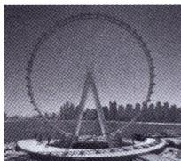

6.[福建师大附中2025高一期末]摩天轮是一种大型转轮状的机械游乐设施,游客坐在摩天轮的座舱里可从高处俯瞰四周景色. 如图, 某摩天轮最高点距离地面高度为 120 m, 转盘直径为 110 m, 均匀设置有 48 个座舱 (按顺时针依次编号为 1 至 48 号), 开启后按逆时针方向匀速旋转, 游客在座舱转到距离地面最近的位置进舱, 转一周需要 30 min. 甲、乙两户家庭去坐摩天轮, 甲家庭先坐上了 1 号座舱, 乙家庭坐上了 k 号座舱, 若从乙家庭坐进座舱开始计时, 10 min 内 (含 10 min) 出现了两户家庭的座舱离地面高度一样的情况, 则 k 的最小值是 \_\_\_\_.

## 相关知识点

暂无已审核的相关知识点。

> 来源：2026版 高中必刷题数学必修第一册
