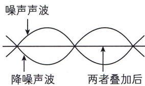

7.[河北石家庄2025高一月考]主动降噪耳机工作的原理是先通过微型麦克风采集周围的噪声,然后降噪芯片生成与噪声振幅相同、相位相反的声波来抵消噪声(如图所示).已知某噪声声波曲线 $f(x)=A\sin\left(\frac{2\pi}{3}x+\varphi\right)$ ( $A>0,0\leqslant\varphi<\pi$ ),其振幅为2,且经过点(1,-2).

(1) 求该噪声声波曲线 $f(x)$ 的解析式以及降噪芯片生成的降噪声波曲线 $g(x)$ 的解析式；

(2) 证明: $g(x) + g(x + 1) + g(x + 2)$ 为定值.

## 相关知识点

暂无已审核的相关知识点。

> 来源：2026版 高中必刷题数学必修第一册
