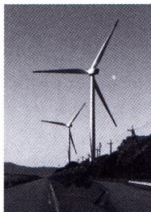

8.[安徽名校联盟2024高一开学考试]近年来,我国逐渐用风能等清洁能源替代传统能源,目前利用风能发电的主要手段是风车发电.如图,风车由一座塔和三个叶片组成,每两个叶片之间的夹角均为 $\frac{2\pi}{3}$ ,现有一个风车,塔高100米,叶片长40米.叶片按照逆时针方向匀速转动,并且每5秒旋转一圈,风车开始旋转时某叶片的一个端点 P 在风车的最低点(此时 P 离地面 60 米). 设点 P 转动 t(秒) 后离地面的距离为 S(米), 则 S 关于 t 的函数关系式为 $S(t) = A \sin(\omega t + \varphi) + B (A > 0, \omega > 0, |\varphi| < \pi)$ .

(1) 求 $S(t)$ 的解析式;

(2)求叶片旋转一圈内点 P 离地面的高度不低于 80 米的时长.

