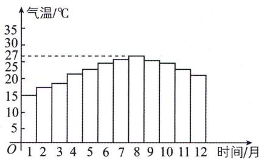

10. 某地为发展旅游事业, 在旅游手册中给出了当地一年 12 个月每个月的平均气温 $y$ (单位: ${}^{ \circ}\mathrm{C}$ ), 如图所示. 根据图中提供的数据, 试用 $y = A \sin (\omega x + \varphi) + b (A > 0, \omega > 0, -\pi < \varphi < 0)$ 近似地拟合出月平均气温 $y$ 与时间 $x$ (单位: 月) 的函数关系式为 \_\_\_\_, $x = 1, 2, \cdots, 12$ .

