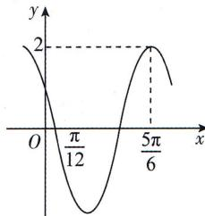

10.[江苏南京金陵中学2025高一期末]已知函数 $f(x)=A\cos(\omega x+\varphi)(A>0,\omega>0,0<\varphi<\pi)$ 的部分图象如图所示,则()

A. $f(x) = 2\cos \left(2x + \frac{\pi}{3}\right)$ B. $f(x)$ 在 $\left[\frac{\pi}{6},\frac{2\pi}{3}\right]$ 上单调递增
C.若 $x_{1},x_{2}\in \left(\frac{\pi}{12},\frac{7\pi}{12}\right),x_{1}\neq x_{2}$ 且 $f(x_{1}) =$ $f(x_{2})$ ，则 $f(x_{1} + x_{2}) = 1$ D.把 $f(x)$ 的图象向右平移 $\frac{5\pi}{12}$ 个单位长度，然后再把所得图象上各点的横坐标变为原来的2倍（纵坐标不变），得到函数 $g(x)$ 的图象，则函数 $y = g\left(x + \frac{3}{2}\pi\right)$ 为偶函数

## 相关知识点

暂无已审核的相关知识点。

> 来源：2026版 高中必刷题数学必修第一册
