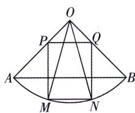

17.（本小题满分15分）[吉林四平实验学校2025高一期末]如图,某小区有一块扇形草地OAB,OA=100, $\angle AOB=\frac{\pi}{2}$ ,为了给小区的孩子提供一个游乐的地方,物业要在其中圈出一块矩形场地PQNM作为儿童乐园使用,其中点M,N在弧AB上,点P,Q分别在线段OA,OB上,且 $AB\parallel MN$ ,设 $\angle MON=\theta(0<\theta<\frac{\pi}{2})$ .

(1) 若 $\theta = \frac{\pi}{6}$ , 求矩形 $PQNM$ 的面积;

(2) 求矩形 PQNM 的面积的最大值, 并求出此时弧 MN 的长度.

