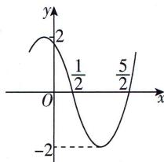

18. (本小题满分 17 分) [安徽芜湖 2025 高一期末] 已知函数 $f(x) = A \cos (\omega x + \varphi) (A > 0, \omega > 0, 0 < \varphi < \pi)$ 的部分图象如图所示.
(1) 求 $f(x)$ 的解析式以及单调递增区间；
(2) 将 $f(x)$ 的图象向右平移 $\frac{1}{4}$ 个单位长度，再将所得图象上所有点的横坐标伸长为原来的 $\frac{\pi}{2}$ 倍，纵坐标不变，得到函数 $g(x)$ 的图象，若关于x的方程 $g(x)=a$ 在 $\left[\frac{\pi}{8},\frac{13\pi}{8}\right]$ 上有两个不等实根，求实数a的取值范围.

