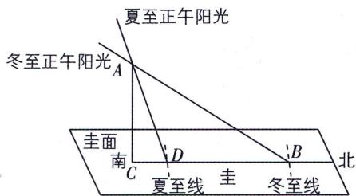

16. 圭表是我国古代通过观察记录正午时影子长度的长短变化来确定季节变化的一种天文仪器, 它包括一根直立的标杆(称为“表”)和一把呈南北方向水平固定摆放的与标杆垂直的长尺(称为“圭”). 当正午阳光照射在表上时, 影子会落在圭面上, 圭面上影子长度最长的那一天定为冬至, 影子长度最短的那一天定为夏至. 如图是根据蚌埠(北纬 32.92°)的地理位置设计的圭表的示意图, 已知蚌埠冬至正午太阳高度角(即∠ABC)约为 33.65°, 夏至正午太阳高度角(即∠ADC)约为 80.51°. 圭面上冬至线和夏至线之间的距离(即 BD 的长)为 7 米, 则表高(即 AC 的长)约为
( ) (已知 tan 33.65°≈2/3,tan 80.51°≈29/5)

A.4.36米 B.4.83米C.5.27米 D.5.41米
