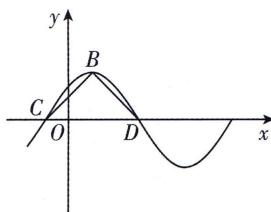

7. (条件开放) [浙江宁波镇海中学 2024 高一期末] 如图是函数 $f(x) = A \sin (\omega x + \varphi)$ 的部分图象, 其中 $\omega > 0, 0 < \varphi < \pi, B$ 为图象的最高点, $C, D$ 为图象与 $x$ 轴的交点, 且 $\triangle BCD$ 为等腰直角三角形, $CD = 2$ , \_\_\_\_. 在① $f\left(x + \frac{1}{2}\right) = f\left(-x + \frac{1}{2}\right)$ ; ② $f\left(x - \frac{1}{2}\right)$ 是奇函数; ③ $f(0) = \frac{\sqrt{2}}{2}$ 这三个条件中任选一个, 补充在横线处并解答.

(1) 求函数 $f(x)$ 的解析式；
(2) 设 $g(x)=f\left(\frac{2}{\pi}x+\frac{1}{2}\right)$ ，不等式 $m\sin^{2}x-g(x)\leqslant4-6m$ 对于 $\forall x\in R$ 恒成立，求 m 的取值范围.
注: 如果选择多个条件分别解答, 按第一个解答计分.

