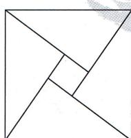

5. 我国古代数学家赵爽的弦图是由四个全等的直角三角形与一个小正方形拼成的一个大正方形(如图). 若小正方形的边长

为2,大正方形的边长为10,直角三角形中较小的锐角为θ,则sin(θ-π/2)-cos(θ+π/6)=( )
A. 5+4√3
B. 5-4√3
C. -5+4√3
D. -5-4√3
10

只有满怀自信的人,才能在任何地方都怀有自信地沉浸在生活中,并实现自己的意志。

建议用时:120 分钟 答案 P271
