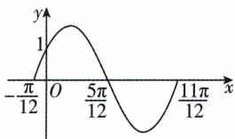

17.（本小题满分15分）[江苏南京2024高一期末]已知函数 $f(x) = A\sin (\omega x + \varphi)$ $\left(\omega>0,A>0,|\varphi|<\frac{\pi}{2}\right)$ 的一段图象过点(0,1)，如图所示.

(1) 求函数 $f(x)$ 的表达式;

(2) 将函数 $y = f(x)$ 的图象向右平移 $\frac{\pi}{4}$ 个单位长度, 得到函数 $y = g(x)$ 的图象, 求 $y = g(x)$ 在区间 $\left[0, \frac{\pi}{2}\right]$ 上的取值范围;

(3) 若 $f(\alpha)=\frac{2}{3}, \alpha\in\left(0,\frac{\pi}{2}\right)$ ，求 $f\left(\alpha-\frac{\pi}{4}\right)$ 的值.

## 相关知识点

暂无已审核的相关知识点。

> 来源：2026版 高中必刷题数学必修第一册
