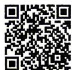

6.[河北石家庄一中2025月考]函数 $f(x)=\frac{2x-5+|x-5|}{\sqrt{10-x^{2}}}$ 的奇偶性是\_\_\_\_。(从“奇函数”“偶函数”“既奇又偶”“非奇非偶”中选一个恰当答案填入)

视频讲解
拍照批改

答案 P183

## 题型3 函数奇偶性的应用

## 相关知识点

暂无已审核的相关知识点。

> 来源：2027版 高中必刷题数学必修第一册RJA
