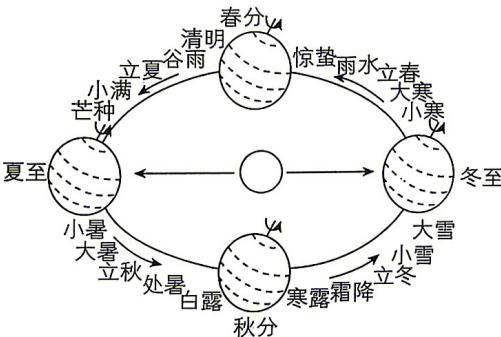

2. 现行的二十四节气是根据地球在黄道(即地球绕太阳公转的轨道)上的位置变化而制定的, 每个节气对应地球在黄道上运动 $15^{\circ}$ 所到达的一个位置. 根据描述, 从立冬到立春对应地球在黄道上运动所对圆心角的弧度数为 ( )

视频讲解
拍照批改

A. $-\frac{\pi}{3}$ B. $\frac{\pi}{3}$ C. $\frac{5\pi}{12}$ D. $\frac{\pi}{2}$

## 相关知识点

暂无已审核的相关知识点。

> 来源：2027版 高中必刷题数学必修第一册RJA
