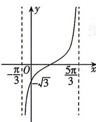

3.[四川成都2026高一月考]已知函数 $f(x)=\tan(\omega x+\varphi)\left(\omega>0,|\varphi|<\frac{\pi}{2}\right)$ 的部分图象如图所示,则 $\omega\varphi=$

A. $\frac{\pi}{3}$ B. $\frac{\pi}{6}$ C. $-\frac{\pi}{3}$ D. $-\frac{\pi}{6}$

## 相关知识点

暂无已审核的相关知识点。

> 来源：2027版 高中必刷题数学必修第一册RJA
