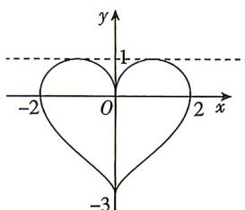

3.[河南省实验中学2026高一期中]如图是一个“心形”图形,这个图形可看作由两个函数的图象构成,则“心形”在x轴上方的图象对应的函数解析式可能为()

A. $y = |x|\sqrt{4 - x^2}$ B. $y = x\sqrt{4 - x^2}$ C. $y = \sqrt{-x^2 + 2|x|}$ D. $y = \sqrt{-x^2 + 2x}$

## 相关知识点

暂无已审核的相关知识点。

> 来源：2027版 高中必刷题数学必修第一册RJA
