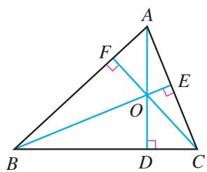

12. 根据下述事实，分别写出含有量词的全称量词命题或存在量词命题：

(1) $1 = 1^{2}$

$$
1 + 3 = 2 ^ {2},
$$

$$
1 + 3 + 5 = 3 ^ {2},
$$

$$
1 + 3 + 5 + 7 = 4 ^ {2},
$$

$$
1 + 3 + 5 + 7 + 9 = 5 ^ {2},
$$

(第 12 (2) 题)

（2）如图，在 $\triangle ABC$ 中， $AD$ ，BE与CF分别为BC，AC与AB边上的高，则 $AD$ ，BE与CF所在的直线交于一点O.
