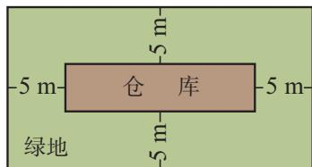

1. 用不等式或不等式组表示下面的不等关系：

(1) 某高速公路规定通过车辆的车货总高度 $h$ (单位: $\mathrm{m}$ ) 从地面算起不能超过 $4 \mathrm{~m}$ ;

(2) a 与 b 的和是非负实数；

（3）如图，在一个面积小于 $350\mathrm{m}^2$ 的矩形场地的中心位置上建造一个仓库，仓库的四周建成绿地，仓库的长 $L$ （单位： $\mathrm{m}$ ）大于宽 $W$ （单位： $\mathrm{m}$ ）的4倍.

(第1（3）题)
