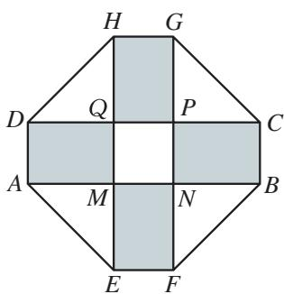

9. 如图，居民小区要建一座八边形的休闲场所，它的主体造型平面图是由两个相同的矩形 ABCD 和 EFGH 构成的面积为 $200 \, m^{2}$ 的十字形地域。计划在正方形 MNPQ 上建一座花坛，造价为 $4200 \, 元/m^{2}$ ；在四个相同的矩形（图中阴影部分）上铺花岗岩地坪，造价为 $210 \, 元/m^{2}$ ；再在四个空角（图中四个三角形）上铺草坪，造价为 $80 \, 元/m^{2}$ 。设总造价为 S（单位：元），AD 长为 x（单位：m）。当 x 为何值时，S 最小？并求出这个最小值。

  
(第9题)
