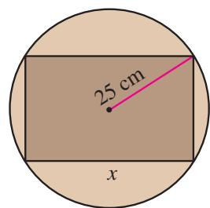

# 练习 3

3. 给定函数 $f(x) = -x + 1$ , $g(x) = (x - 1)^2$ , $x \in \mathbf{R}$ ,

(1) 画出函数 $f(x)$ ， $g(x)$ 的图象；

(第1题)

(2) $\forall x \in \mathbf{R}$ , 用 $m(x)$ 表示 $f(x)$ , $g(x)$ 中的最小者, 记为 $m(x) = \min\{f(x), g(x)\}$ , 请分别用图象法和解析法表示函数 $m(x)$ .

对于一个具体的问题，如果涉及函数，那么应当学会选择恰当的方法表示问题中的函数关系.

## 解析

本来源未提供本题解析。

## 本节相关知识（范围关联）

- [函数的三种表示法](../%E7%9F%A5%E8%AF%86%E7%82%B9/%E7%9F%A5%E8%AF%86%E7%82%B9-%E5%87%BD%E6%95%B0%E7%9A%84%E4%B8%89%E7%A7%8D%E8%A1%A8%E7%A4%BA%E6%B3%95.md)
- [分段函数的概念](../%E7%9F%A5%E8%AF%86%E7%82%B9/%E7%9F%A5%E8%AF%86%E7%82%B9-%E5%88%86%E6%AE%B5%E5%87%BD%E6%95%B0%E7%9A%84%E6%A6%82%E5%BF%B5.md)

## 所属组织

- [3.1.2 函数的表示法](../%E9%A2%98%E5%9E%8B/%E6%8C%89%E7%AB%A0%E8%8A%82%E5%88%86%E7%B1%BB/%E4%BA%BA%E6%95%99A-%E5%BF%85%E4%BF%AE%E7%AC%AC%E4%B8%80%E5%86%8C/%E7%AC%AC%E4%B8%89%E7%AB%A0%20%E5%87%BD%E6%95%B0%E7%9A%84%E6%A6%82%E5%BF%B5%E4%B8%8E%E6%80%A7%E8%B4%A8/3.1%20%E5%87%BD%E6%95%B0%E7%9A%84%E6%A6%82%E5%BF%B5%E5%8F%8A%E5%85%B6%E8%A1%A8%E7%A4%BA.md)
