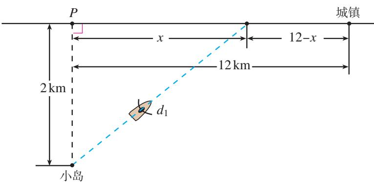

15. 如图所示，一座小岛距离海岸线上最近的点 $P$ 的距离是 $2\mathrm{km}$ ，从点 $P$ 沿海岸正东 $12\mathrm{km}$ 处有一个城镇.

(1) 假设一个人驾驶的小船的平均速度为 $3 \mathrm{~km} / \mathrm{h}$ , 步行的速度是 $5 \mathrm{~km} / \mathrm{h}, t$ (单位: h) 表示他从小岛到城镇的时间, $x$ (单位: km) 表示此人将船停在海岸处距点 $P$ 的距离. 请将 $t$ 表示为 $x$ 的函数.

（2）如果将船停在距点 $P4\mathrm{km}$ 处，那么从小岛到城镇要多长时间（精确到0.1h)?

  
(第 15 题)
