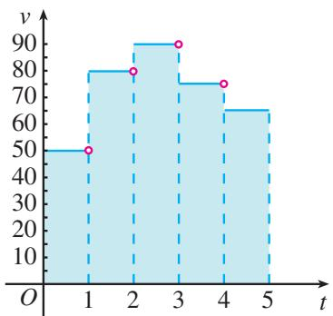

例 2 一辆汽车在某段路程中行驶的平均速率 v（单位：km/h）与时间 t（单位：h）的关系如图 3.4-1 所示，

（1）求图3.4-1中阴影部分的面积，并说明所求面积的实际含义；

（2）假设这辆汽车的里程表在汽车行驶这段路程前的读数为 $2004 \, km$ ，试建立行驶这段路程时汽车里程表读数 s（单位：km）与时间 t 的函数解析式，并画出相应的图象.

  
图3.4-1

你能根据图 3.4-1 画出汽车行驶路程关于时间变化的图象吗？

