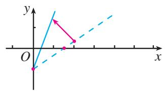

# 习题3.4 拓广探索 第4题

4. 图（1）是某条公共汽车线路收支差额 $y$ 关于乘客量 $x$ 的图象.

（1）试说明图（1）上点 $A$ ，点 $B$ 以及射线 $AB$ 上的点的实际意义；

（2）由于目前本条线路亏损，公司有关人员提出了两种扭亏为盈的建议，如图（2）（3）所示.你能根据图象，说明这两种建议是什么吗？

(1)

  
(2)  
(第4题)

  
(3)

## 解析

本来源未提供本题解析。

## 所属组织

- [习题3.4](../%E9%A2%98%E5%9E%8B/%E6%8C%89%E7%AB%A0%E8%8A%82%E5%88%86%E7%B1%BB/%E4%BA%BA%E6%95%99A-%E5%BF%85%E4%BF%AE%E7%AC%AC%E4%B8%80%E5%86%8C/%E7%AC%AC%E4%B8%89%E7%AB%A0%20%E5%87%BD%E6%95%B0%E7%9A%84%E6%A6%82%E5%BF%B5%E4%B8%8E%E6%80%A7%E8%B4%A8/3.4%20%E5%87%BD%E6%95%B0%E7%9A%84%E5%BA%94%E7%94%A8%28%E4%B8%80%29.md)
