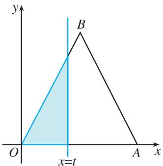

14. 某商场经营一批进价为 30 元/件的商品，在市场试销中发现，此商品的销售单价 x（单位：元）与日销售量 y（单位：件）之间有如下表所示的关系.

<table><tr><td>x</td><td>...</td><td>30</td><td>40</td><td>45</td><td>50</td><td>...</td></tr><tr><td>y</td><td>...</td><td>60</td><td>30</td><td>15</td><td>0</td><td>...</td></tr></table>

(第 13 题)

（1）根据表中提供的数据描出实数对 $(x, y)$ 的对应点，根据画出的点猜想 $y$ 与 $x$ 之间的函数关系，并写出一个函数解析式；

(2) 设经营此商品的日销售利润为 $P$ (单位：元)，根据上述关系，写出 $P$ 关于 $x$ 的函数解析式，并求销售单价为多少元时，才能获得最大日销售利润.
