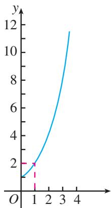

9. 如图，某池塘里浮萍的面积 $y$ （单位： $\mathrm{m}^2$ ）与时间 $t$ （单位：月）的关系为 $y = a^t$ . 关于下列说法：

① 浮萍每月的增长率为 1;

② 第 5 个月时，浮萍面积就会超过 $30 \, m^{2}$ ;

③ 浮萍每月增加的面积都相等；

(第9题)

④ 若浮萍蔓延到 $2\mathrm{m}^2$ ， $3\mathrm{m}^2$ ， $6\mathrm{m}^2$ 所经过的时间分别是 $t_1$ ， $t_2$ ， $t_3$ ，则 $t_1 + t_2 = t_3$

其中正确的说法是（ ）.

(A) ①② (B) ①②③ (C) ①②④ (D) ①②③④
