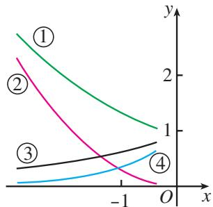
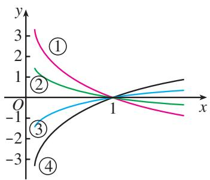

1. 选择题

(1) 函数 $y = -2^{-x}$ 与 $y = 2^{x}$ 的图象（）.

(A) 关于 $x$ 轴对称 (B) 关于 $y$ 轴对称

(C) 关于原点对称 (D) 关于直线 $y = x$ 对称

(2) 如图 (1)，①②③④中不属于函数 $y = 2^x$ ， $y = 6^x$ ， $y = \left(\frac{1}{2}\right)^x$ 的一个是（ ）.
(A) ① (B) ② (C) ③ (D) ④

（3）如图（2），①②③④中不属于函数 $y = \log_{\frac{1}{2}}x$ ， $y = \log_{\frac{1}{3}}x$ ， $y = \log_2 x$ 的一个是( ).
(A) ① (B) ② (C) ③ (D) ④

(1)

(2)

(第1题)
