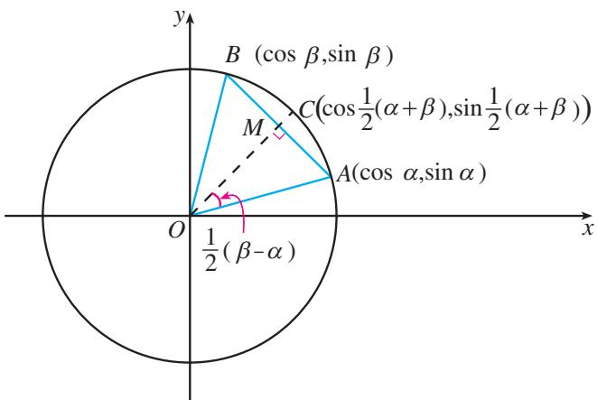

19. 你能利用所给图形，证明下列两个等式吗？

$$
\frac {1}{2} (\sin \alpha + \sin \beta) = \sin \frac {\alpha + \beta}{2} \cos \frac {\alpha - \beta}{2};
$$

$$
\frac {1}{2} (\cos \alpha + \cos \beta) = \cos \frac {\alpha + \beta}{2} \cos \frac {\alpha - \beta}{2}.
$$

  
(第 19 题)
