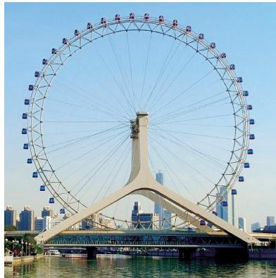

例 2 摩天轮是一种大型转轮状的机械建筑设施，游客坐在摩天轮的座舱里慢慢地往上转，可以从高处俯瞰四周景色。如图 5.6-9，某摩天轮最高点距离地面高度为 120 m，转盘直径为 110 m，设置有 48 个座舱，开启后按逆时针方向匀速旋转，游客在座舱转到距离地面最近的位置进舱，转一周大约需要 30 min。

（1）游客甲坐上摩天轮的座舱，开始转动 $t$ min后距离地面的高度为 $H$ m，求在转动一周的过程中， $H$ 关于 $t$ 的函数解析式；

图5.6-9

(2) 求游客甲在开始转动 5 min 后距离地面的高度;

（3）若甲、乙两人分别坐在两个相邻的座舱里，在运行一周的过程中，求两人距离地面的高度差 $h$ （单位：m）关于 $t$ 的函数解析式，并求高度差的最大值（精确到0.1）.

