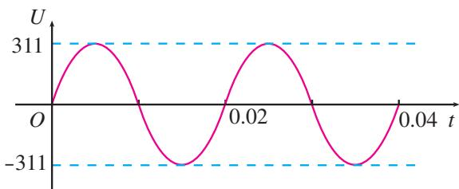

3. 一台发电机产生的电流是正弦式电流，电压和时间之间的关系如图所示。由图象说出它的周期、频率和电压的最大值，并求出电压 $U$ （单位：V）关于时间 $t$ （单位：s）的函数解析式。

  
(第3题)

匀速圆周运动、简谐运动和交变电流都是理想化的运动变化现象，可以用三角函数模型准确地描述它们的运动变化规律。在现实生活中也有大量运动变化现象，仅在一定范围内呈现出近似于周期变化的特点，这些现象也可以借助三角函数近似地描述。
