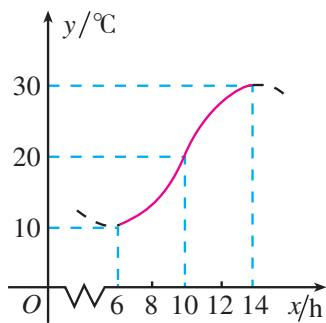

# 例 1 根据某地一天温度变化曲线拟合三角函数解析式

例 1 如图 5.7-3，某地一天从 6～14 时的温度变化曲线近似满足函数

$$
y = A \sin (\omega x + \varphi) + b.
$$

(1) 求这一天 6\~14 时的最大温差；

(2) 写出这段曲线的函数解析式.

## 题目补充材料（来源原文）

## 本节相关知识（范围关联）

- [函数 y=Asin(ωx+φ) 的物理意义与简谐运动模型](../%E7%9F%A5%E8%AF%86%E7%82%B9/%E7%9F%A5%E8%AF%86%E7%82%B9-%E5%87%BD%E6%95%B0%20y%3DAsin%28%CF%89x%2B%CF%86%29%20%E7%9A%84%E7%89%A9%E7%90%86%E6%84%8F%E4%B9%89%E4%B8%8E%E7%AE%80%E8%B0%90%E8%BF%90%E5%8A%A8%E6%A8%A1%E5%9E%8B.md)

## 解析

- [例 1 根据某地一天温度变化曲线拟合三角函数解析式·解析](%E8%A7%A3%E6%9E%90/A070000004618.md)

## 所属组织

- [5.7 三角函数的应用](../%E9%A2%98%E5%9E%8B/%E6%8C%89%E7%AB%A0%E8%8A%82%E5%88%86%E7%B1%BB/%E4%BA%BA%E6%95%99A-%E5%BF%85%E4%BF%AE%E7%AC%AC%E4%B8%80%E5%86%8C/%E7%AC%AC%E4%BA%94%E7%AB%A0%20%E4%B8%89%E8%A7%92%E5%87%BD%E6%95%B0/5.7%20%E4%B8%89%E8%A7%92%E5%87%BD%E6%95%B0%E7%9A%84%E5%BA%94%E7%94%A8.md)
