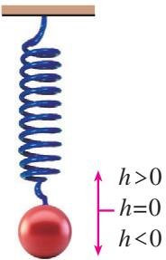

2. 如图，弹簧挂着的小球做上下运动，它在 $t$ s 时相对于平衡位置的高度 $h$ （单位：cm）由关系式 $h = 2\sin \left(t + \frac{\pi}{4}\right)$ 确定。以 $t$ 为横坐标， $h$ 为纵坐标，画出这个函数在一个周期的闭区间上的图象，并回答下列问题：

（1）小球在开始振动（即 $t = 0$ ）时的位置在哪里？

(2) 小球的最高点和最低点与平衡位置的距离分别是多少?

（3）经过多少时间小球往复运动一次？

(第2题)

（4）每秒钟小球能往复振动多少次？

