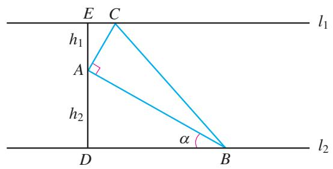

25. 如图，已知直线 $l_{1} \parallel l_{2}$ ， $A$ 是 $l_{1}, l_{2}$ 之间的一定点，并且点 $A$ 到 $l_{1}, l_{2}$ 的距离分别为 $h_{1}, h_{2}$ . $B$ 是直线 $l_{2}$ 上一动点，作 $AC \perp AB$ ，且使 $AC$ 与直线 $l_{1}$ 交于点 $C$ . 设 $\angle ABD = \alpha$ .

  
(第 25 题)

（1）写出 $\triangle ABC$ 的面积 $S$ 关于角 $\alpha$ 的函数解析式 $S(\alpha)$ ；

(2) 画出上述函数的图象；

(3) 由(2)中的图象求 $S(\alpha)$ 的最小值.
