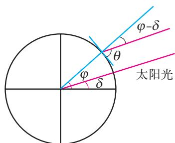

27. 在地球公转过程中，太阳直射点的纬度随时间周而复始不断变化.

(1) 如图，设地球表面某地正午太阳高度角为 $\theta$ ， $\delta$ 为此时太阳直射点的纬度， $\varphi$ 为当地的纬度值，那么这三个量满足 $\theta = 90^{\circ} - |\varphi - \delta|$ . 某科技小组以某年春分（太阳直射赤道且随后太阳直射点逐渐北移的时间）为初始时间，统计了连续400天太阳直射点的纬度平均值（太阳直射北半球时取正值，太阳直射南半球时取负值）。下面是该科技小组的三处观测站成员在春分后第45天测得的当地太阳高度角数据：

  
(第 27 题)

<table><tr><td rowspan="2">项目</td><td colspan="3">观测站</td></tr><tr><td>A</td><td>B</td><td>C</td></tr><tr><td>观测站所在纬度φ/度</td><td>40.000 0</td><td>23.439 3</td><td>0.000 0</td></tr><tr><td>观测站正午太阳高度角θ/度</td><td>66.387 0</td><td>82.946 4</td><td>73.614 1</td></tr><tr><td>太阳直射点的纬度δ/度</td><td></td><td></td><td></td></tr><tr><td>太阳直射点的纬度平均值/度</td><td colspan="3"></td></tr></table>
