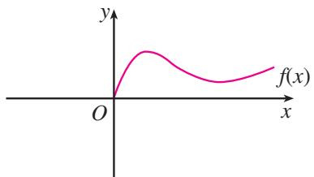
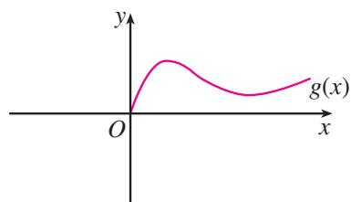

# 练习 1

1. 已知 $f(x)$ 是偶函数， $g(x)$ 是奇函数，试将下图补充完整.

  
(第1题)

## 解析

本来源未提供本题解析。

## 本节相关知识（范围关联）

- [偶函数](../%E7%9F%A5%E8%AF%86%E7%82%B9/%E5%81%B6%E5%87%BD%E6%95%B0--000127.md)
- [奇函数](../%E7%9F%A5%E8%AF%86%E7%82%B9/%E5%A5%87%E5%87%BD%E6%95%B0--000128.md)

## 所属组织

- [3.2.2 奇偶性](../%E9%A2%98%E5%9E%8B/%E4%BA%BA%E6%95%99A-%E5%BF%85%E4%BF%AE%E7%AC%AC%E4%B8%80%E5%86%8C/%E7%AC%AC%E4%B8%89%E7%AB%A0%20%E5%87%BD%E6%95%B0%E7%9A%84%E6%A6%82%E5%BF%B5%E4%B8%8E%E6%80%A7%E8%B4%A8/3.2%20%E5%87%BD%E6%95%B0%E7%9A%84%E5%9F%BA%E6%9C%AC%E6%80%A7%E8%B4%A8/3.2.2%20%E5%A5%87%E5%81%B6%E6%80%A7.md)
