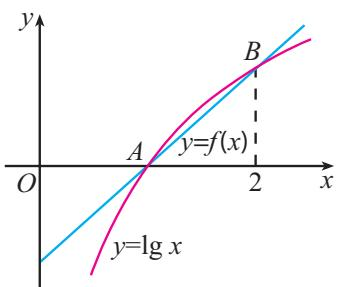
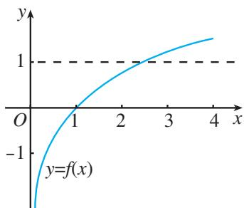

# 练习 3

3. 如图，对数函数 $y = \lg x$ 的图象与一次函数 $y = f(x)$ 的图象有 $A$ ， $B$ 两个公共点。求一次函数 $y = f(x)$ 的解析式。

  
(第3题)

  
(第4题)

## 解析

本来源未提供本题解析。

## 本节相关知识（范围关联）

- [不同函数增长的差异](../%E7%9F%A5%E8%AF%86%E7%82%B9/%E4%B8%8D%E5%90%8C%E5%87%BD%E6%95%B0%E5%A2%9E%E9%95%BF%E7%9A%84%E5%B7%AE%E5%BC%82--000146.md)

## 所属组织

- [4.4.3 不同函数增长的差异](../%E9%A2%98%E5%9E%8B/%E4%BA%BA%E6%95%99A-%E5%BF%85%E4%BF%AE%E7%AC%AC%E4%B8%80%E5%86%8C/%E7%AC%AC%E5%9B%9B%E7%AB%A0%20%E6%8C%87%E6%95%B0%E5%87%BD%E6%95%B0%E4%B8%8E%E5%AF%B9%E6%95%B0%E5%87%BD%E6%95%B0/4.4%20%E5%AF%B9%E6%95%B0%E5%87%BD%E6%95%B0/4.4.3%20%E4%B8%8D%E5%90%8C%E5%87%BD%E6%95%B0%E5%A2%9E%E9%95%BF%E7%9A%84%E5%B7%AE%E5%BC%82.md)
