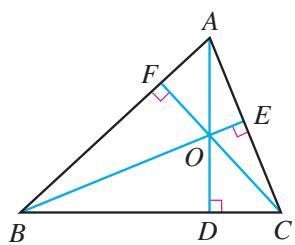

# 第一章 集合与常用逻辑用语 复习参考题 1 拓广探索 第12题

12. 根据下述事实，分别写出含有量词的全称量词命题或存在量词命题：

(1) $1 = 1^{2}$

$$
1 + 3 = 2 ^ {2},
$$

$$
1 + 3 + 5 = 3 ^ {2},
$$

$$
1 + 3 + 5 + 7 = 4 ^ {2},
$$

$$
1 + 3 + 5 + 7 + 9 = 5 ^ {2},
$$

(第 12 (2) 题)

（2）如图，在 $\triangle ABC$ 中， $AD$ ，BE与CF分别为BC，AC与AB边上的高，则 $AD$ ，BE与CF所在的直线交于一点O.

## 解析

本来源未提供本题解析。

## 所属组织

- [第一章 集合与常用逻辑用语 复习参考题 1](../%E9%A2%98%E5%9E%8B/%E4%BA%BA%E6%95%99A-%E5%BF%85%E4%BF%AE%E7%AC%AC%E4%B8%80%E5%86%8C/%E7%AC%AC%E4%B8%80%E7%AB%A0%20%E9%9B%86%E5%90%88%E4%B8%8E%E5%B8%B8%E7%94%A8%E9%80%BB%E8%BE%91%E7%94%A8%E8%AF%AD/%E7%AC%AC%E4%B8%80%E7%AB%A0%20%E9%9B%86%E5%90%88%E4%B8%8E%E5%B8%B8%E7%94%A8%E9%80%BB%E8%BE%91%E7%94%A8%E8%AF%AD%20%E5%A4%8D%E4%B9%A0%E5%8F%82%E8%80%83%E9%A2%98%201.md)
