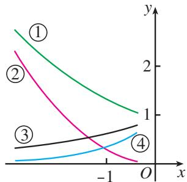
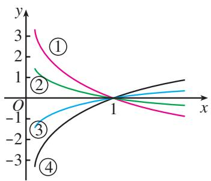

# 第四章 指数函数与对数函数 复习参考题4 复习巩固 第1题

1. 选择题

(1) 函数 $y = -2^{-x}$ 与 $y = 2^{x}$ 的图象（）.

(A) 关于 $x$ 轴对称 (B) 关于 $y$ 轴对称

(C) 关于原点对称 (D) 关于直线 $y = x$ 对称

(2) 如图 (1)，①②③④中不属于函数 $y = 2^x$ ， $y = 6^x$ ， $y = \left(\frac{1}{2}\right)^x$ 的一个是（ ）.
(A) ① (B) ② (C) ③ (D) ④

（3）如图（2），①②③④中不属于函数 $y = \log_{\frac{1}{2}}x$ ， $y = \log_{\frac{1}{3}}x$ ， $y = \log_2 x$ 的一个是( ).
(A) ① (B) ② (C) ③ (D) ④

(1)

(2)

(第1题)

## 解析

本来源未提供本题解析。

## 所属组织

- [第四章 指数函数与对数函数 复习参考题4](../%E9%A2%98%E5%9E%8B/%E4%BA%BA%E6%95%99A-%E5%BF%85%E4%BF%AE%E7%AC%AC%E4%B8%80%E5%86%8C/%E7%AC%AC%E5%9B%9B%E7%AB%A0%20%E6%8C%87%E6%95%B0%E5%87%BD%E6%95%B0%E4%B8%8E%E5%AF%B9%E6%95%B0%E5%87%BD%E6%95%B0/%E7%AC%AC%E5%9B%9B%E7%AB%A0%20%E6%8C%87%E6%95%B0%E5%87%BD%E6%95%B0%E4%B8%8E%E5%AF%B9%E6%95%B0%E5%87%BD%E6%95%B0%20%E5%A4%8D%E4%B9%A0%E5%8F%82%E8%80%83%E9%A2%984.md)
