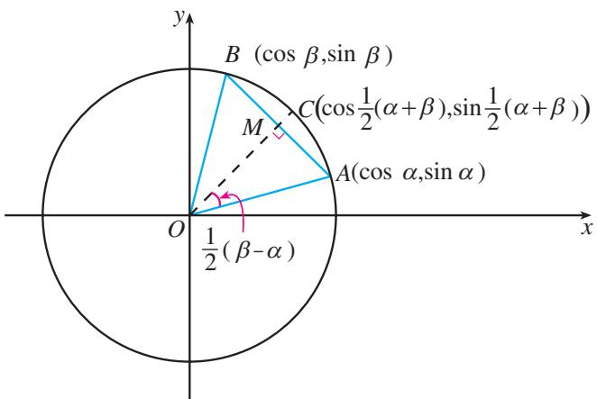

# 习题5.5 拓广探索 第19题

19. 你能利用所给图形，证明下列两个等式吗？

$$
\frac {1}{2} (\sin \alpha + \sin \beta) = \sin \frac {\alpha + \beta}{2} \cos \frac {\alpha - \beta}{2};
$$

$$
\frac {1}{2} (\cos \alpha + \cos \beta) = \cos \frac {\alpha + \beta}{2} \cos \frac {\alpha - \beta}{2}.
$$

  
(第 19 题)

## 解析

本来源未提供本题解析。

## 所属组织

- [习题5.5](../%E9%A2%98%E5%9E%8B/%E4%BA%BA%E6%95%99A-%E5%BF%85%E4%BF%AE%E7%AC%AC%E4%B8%80%E5%86%8C/%E7%AC%AC%E4%BA%94%E7%AB%A0%20%E4%B8%89%E8%A7%92%E5%87%BD%E6%95%B0/5.5%20%E4%B8%89%E8%A7%92%E6%81%92%E7%AD%89%E5%8F%98%E6%8D%A2/%E4%B9%A0%E9%A2%985.5.md)
