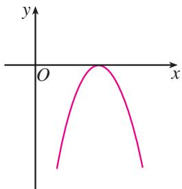
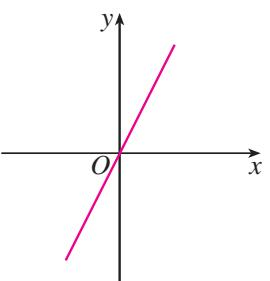
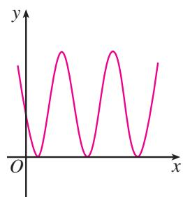
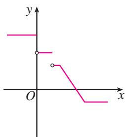

# 习题4.5 复习巩固 第1题

1. 下列函数图象与 $x$ 轴均有交点，其中不能用二分法求其零点的是\_\_\_\_。（填写上所有符合条件的图号）

①

②

③

  
④

## 解析

本来源未提供本题解析。

## 所属组织

- [习题4.5](../%E9%A2%98%E5%9E%8B/%E4%BA%BA%E6%95%99A-%E5%BF%85%E4%BF%AE%E7%AC%AC%E4%B8%80%E5%86%8C/%E7%AC%AC%E5%9B%9B%E7%AB%A0%20%E6%8C%87%E6%95%B0%E5%87%BD%E6%95%B0%E4%B8%8E%E5%AF%B9%E6%95%B0%E5%87%BD%E6%95%B0/4.5%20%E5%87%BD%E6%95%B0%E7%9A%84%E5%BA%94%E7%94%A8%28%E4%BA%8C%29/%E4%B9%A0%E9%A2%984.5.md)
