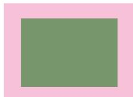

# 练习 2

2. 如图, 在长为 $8 \mathrm{~m}$ , 宽为 $6 \mathrm{~m}$ 的矩形地面的四周种植花卉, 中间种植草坪. 如果要求花卉带的宽度相同, 且草坪的面积不超过总面积的一半, 那么花卉带的宽度应为多少米?

## 解析

本来源未提供本题解析。

## 本节相关知识（范围关联）

- [二次函数与一元二次不等式](../%E7%9F%A5%E8%AF%86%E7%82%B9/%E4%BA%8C%E6%AC%A1%E5%87%BD%E6%95%B0%E4%B8%8E%E4%B8%80%E5%85%83%E4%BA%8C%E6%AC%A1%E4%B8%8D%E7%AD%89%E5%BC%8F--000026.md)

## 所属组织

- [2.3 二次函数与一元二次方程、不等式](../%E9%A2%98%E5%9E%8B/%E4%BA%BA%E6%95%99A-%E5%BF%85%E4%BF%AE%E7%AC%AC%E4%B8%80%E5%86%8C/%E7%AC%AC%E4%BA%8C%E7%AB%A0%20%E4%B8%80%E5%85%83%E4%BA%8C%E6%AC%A1%E5%87%BD%E6%95%B0%E3%80%81%E6%96%B9%E7%A8%8B%E5%92%8C%E4%B8%8D%E7%AD%89%E5%BC%8F/2.3%20%E4%BA%8C%E6%AC%A1%E5%87%BD%E6%95%B0%E4%B8%8E%E4%B8%80%E5%85%83%E4%BA%8C%E6%AC%A1%E6%96%B9%E7%A8%8B%E3%80%81%E4%B8%8D%E7%AD%89%E5%BC%8F/2.3%20%E4%BA%8C%E6%AC%A1%E5%87%BD%E6%95%B0%E4%B8%8E%E4%B8%80%E5%85%83%E4%BA%8C%E6%AC%A1%E6%96%B9%E7%A8%8B%E3%80%81%E4%B8%8D%E7%AD%89%E5%BC%8F.md)
