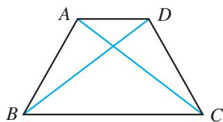

# 练习 1

1. 下列各题中，哪些 $p$ 是 $q$ 的充要条件？

(1) p：三角形为等腰三角形，q：三角形存在两角相等；

(2) $p: \odot O$ 内两条弦相等, $q: \odot O$ 内两条弦所对的圆周角相等;

(3) $p: A \cap B$ 为空集, $q: A$ 与 $B$ 之一为空集.

## 解析

本来源未提供本题解析。

## 本节相关知识（范围关联）

- [充要条件](../%E7%9F%A5%E8%AF%86%E7%82%B9/%E5%85%85%E8%A6%81%E6%9D%A1%E4%BB%B6--000105.md)
- [数学定义与充要条件的关系](../%E7%9F%A5%E8%AF%86%E7%82%B9/%E6%95%B0%E5%AD%A6%E5%AE%9A%E4%B9%89%E4%B8%8E%E5%85%85%E8%A6%81%E6%9D%A1%E4%BB%B6%E7%9A%84%E5%85%B3%E7%B3%BB--000106.md)

## 所属组织

- [1.4.2 充要条件](../%E9%A2%98%E5%9E%8B/%E4%BA%BA%E6%95%99A-%E5%BF%85%E4%BF%AE%E7%AC%AC%E4%B8%80%E5%86%8C/%E7%AC%AC%E4%B8%80%E7%AB%A0%20%E9%9B%86%E5%90%88%E4%B8%8E%E5%B8%B8%E7%94%A8%E9%80%BB%E8%BE%91%E7%94%A8%E8%AF%AD/1.4%20%E5%85%85%E5%88%86%E6%9D%A1%E4%BB%B6%E4%B8%8E%E5%BF%85%E8%A6%81%E6%9D%A1%E4%BB%B6/1.4.2%20%E5%85%85%E8%A6%81%E6%9D%A1%E4%BB%B6.md)
