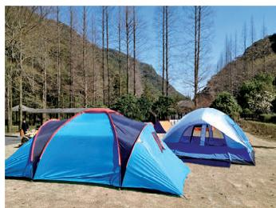

# 第二章 一元二次函数、方程和不等式 复习参考题 2 复习巩固 第1题

1. 某夏令营有 48 人，出发前要从 A，B 两种型号的帐篷中选择一种。A 型号的帐篷比 B 型号的少 5 顶。若只选 A 型号的，每顶帐篷住 4 人，则帐篷不够；每顶帐篷住 5 人，则有一顶帐篷没有住满。若只选 B 型号的，每顶帐篷住 3 人，则帐篷不够；每顶帐篷住 4 人，则有帐篷多余。设 A 型号的帐篷有 x 顶，用不等式将题目中的不等关系表示出来。

  
(第1题)

## 解析

本来源未提供本题解析。

## 所属组织

- [第二章 一元二次函数、方程和不等式 复习参考题 2](../%E9%A2%98%E5%9E%8B/%E4%BA%BA%E6%95%99A-%E5%BF%85%E4%BF%AE%E7%AC%AC%E4%B8%80%E5%86%8C/%E7%AC%AC%E4%BA%8C%E7%AB%A0%20%E4%B8%80%E5%85%83%E4%BA%8C%E6%AC%A1%E5%87%BD%E6%95%B0%E3%80%81%E6%96%B9%E7%A8%8B%E5%92%8C%E4%B8%8D%E7%AD%89%E5%BC%8F/%E7%AC%AC%E4%BA%8C%E7%AB%A0%20%E4%B8%80%E5%85%83%E4%BA%8C%E6%AC%A1%E5%87%BD%E6%95%B0%E3%80%81%E6%96%B9%E7%A8%8B%E5%92%8C%E4%B8%8D%E7%AD%89%E5%BC%8F%20%E5%A4%8D%E4%B9%A0%E5%8F%82%E8%80%83%E9%A2%98%202.md)
