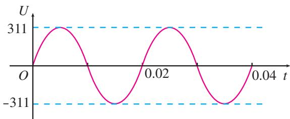

# 电压函数图象练习

3. 一台发电机产生的电流是正弦式电流，电压和时间之间的关系如图所示。由图象说出它的周期、频率和电压的最大值，并求出电压 $U$ （单位：V）关于时间 $t$ （单位：s）的函数解析式。

  
(第3题)

## 解析

本来源未提供本题解析。

## 本节相关知识（范围关联）

- [三角函数模型的应用步骤](../%E7%9F%A5%E8%AF%86%E7%82%B9/%E4%B8%89%E8%A7%92%E5%87%BD%E6%95%B0%E6%A8%A1%E5%9E%8B%E7%9A%84%E5%BA%94%E7%94%A8%E6%AD%A5%E9%AA%A4--000088.md)

## 所属组织

- [5.7 三角函数的应用](../%E9%A2%98%E5%9E%8B/%E4%BA%BA%E6%95%99A-%E5%BF%85%E4%BF%AE%E7%AC%AC%E4%B8%80%E5%86%8C/%E7%AC%AC%E4%BA%94%E7%AB%A0%20%E4%B8%89%E8%A7%92%E5%87%BD%E6%95%B0/5.7%20%E4%B8%89%E8%A7%92%E5%87%BD%E6%95%B0%E7%9A%84%E5%BA%94%E7%94%A8/5.7%20%E4%B8%89%E8%A7%92%E5%87%BD%E6%95%B0%E7%9A%84%E5%BA%94%E7%94%A8.md)
