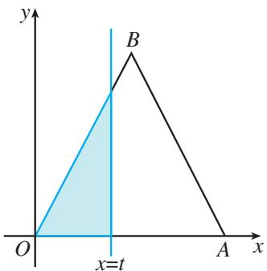

# 第三章 函数的概念与性质 复习参考题 3 拓广探索 第14题

14. 某商场经营一批进价为 30 元/件的商品，在市场试销中发现，此商品的销售单价 x（单位：元）与日销售量 y（单位：件）之间有如下表所示的关系.

<table><tr><td>x</td><td>...</td><td>30</td><td>40</td><td>45</td><td>50</td><td>...</td></tr><tr><td>y</td><td>...</td><td>60</td><td>30</td><td>15</td><td>0</td><td>...</td></tr></table>

(第 13 题)

（1）根据表中提供的数据描出实数对 $(x, y)$ 的对应点，根据画出的点猜想 $y$ 与 $x$ 之间的函数关系，并写出一个函数解析式；

(2) 设经营此商品的日销售利润为 $P$ (单位：元)，根据上述关系，写出 $P$ 关于 $x$ 的函数解析式，并求销售单价为多少元时，才能获得最大日销售利润.

## 解析

本来源未提供本题解析。

## 所属组织

- [第三章 函数的概念与性质 复习参考题 3](../%E9%A2%98%E5%9E%8B/%E4%BA%BA%E6%95%99A-%E5%BF%85%E4%BF%AE%E7%AC%AC%E4%B8%80%E5%86%8C/%E7%AC%AC%E4%B8%89%E7%AB%A0%20%E5%87%BD%E6%95%B0%E7%9A%84%E6%A6%82%E5%BF%B5%E4%B8%8E%E6%80%A7%E8%B4%A8/%E7%AC%AC%E4%B8%89%E7%AB%A0%20%E5%87%BD%E6%95%B0%E7%9A%84%E6%A6%82%E5%BF%B5%E4%B8%8E%E6%80%A7%E8%B4%A8%20%E5%A4%8D%E4%B9%A0%E5%8F%82%E8%80%83%E9%A2%98%203.md)
